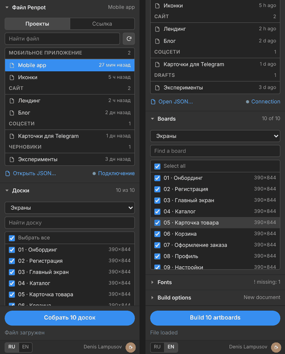

<h1 align="center">Penpot → Illustrator</h1>

Панель для Adobe Illustrator, которая собирает макеты из <a href="https://penpot.app">Penpot</a> в редактируемые векторные документы. 
<a href="#english">English version below ↓</a>

---

## Русский

### Что это

**Penpot → Illustrator** переносит доски из файла Penpot в Illustrator так, чтобы с ними можно было сразу работать: фигуры остаются векторными, тексты — настоящими абзацами с нужными шрифтами, тени и эффекты — живыми. Никакого PDF «по буквам» и ручной склейки текста.

### Возможности

- **Выбор файла прямо в панели** — проекты и файлы вашей команды Penpot, поиск, время изменения; либо ссылка на файл, либо JSON.
- **Доски → монтажные области** — раскладка как на холсте Penpot или сеткой, выбор отдельных досок; миниатюры досок списком или плитками.
- **Фигуры и контуры** — прямоугольники с разными скруглениями, эллипсы, контуры Безье, составные контуры, логические операции, маски и обрезка досок.
- **Тексты абзацами** — шрифт, насыщенность, кегль, интерлиньяж, трекинг, цвет, выравнивание, регистр, подчёркивание; надстрочные и подстрочные знаки; сверка переносов с Penpot.
- **Шрифты** — автоподбор установленных шрифтов, ручная замена, автоматическая установка недостающих из Google Fonts.
- **Заливки и обводки** — сплошные и градиентные, несколько обводок, внутренняя/внешняя/центральная, пунктир, наконечники линий.
- **Эффекты** — наружные и внутренние тени, размытие слоя, размытие фона («стекло»), режимы наложения, прозрачность.
- **Трансформации** — поворот, отражение, наклон.
- **Картинки** — встраиваются или связываются; WebP и SVG конвертируются автоматически.
- **Библиотеки** — цвета Penpot становятся глобальными образцами Illustrator, типографика — стилями абзаца и символа; объекты и тексты связаны с ними.
- **Привязка к Penpot** — в «Примечании» каждого объекта хранится его id в Penpot (переживает копирование и группировку).
- **Прочее** — скрытые слои переносятся скрытыми, модульные сетки становятся направляющими, порядок слоёв в досках с авторасстановкой как в Penpot.
- **Интерфейс** — в стиле панелей Illustrator, подстраивается под 4 темы, русский и английский язык.

### Требования

- Adobe Illustrator **CC 2019 (23) и новее** — Windows или macOS.
- Penpot — облачный [design.penpot.app](https://design.penpot.app) или собственный сервер.
- Токен доступа Penpot (для работы с проектами и загрузки картинок).

### Установка

1. Скачайте репозиторий: **Code → Download ZIP** и распакуйте архив.
2. Запустите установщик:
   - **Windows** — двойной щелчок по `install.bat`;
   - **macOS** — двойной щелчок по `install.command`. Если macOS не даёт запустить файл: щелчок правой кнопкой → «Открыть», или в Терминале `chmod +x install.command`.
3. Перезапустите Illustrator и откройте **Окно → Расширения → Penpot → Illustrator**.

Установщик копирует панель в папку расширений Adobe и разрешает загрузку неподписанных расширений (`PlayerDebugMode`). Права администратора не нужны. Иконки панели хранятся в репозитории в виде `*.png.b64` — установщик сам превращает их в PNG.

### Первый запуск

1. В Penpot создайте токен: **Ваш аккаунт → Токены доступа → Создать токен**.
   На собственном сервере токены включаются флагом `enable-access-tokens` в `PENPOT_FLAGS`.
2. В панели нажмите **Подключение**, укажите адрес сервера и токен, нажмите **Проверить**.
3. На вкладке **Проекты** выберите файл → отметьте доски → **Собрать**.

Без токена можно открыть файл через **Открыть JSON…** (ответ API `get-file`), но картинки могут не загрузиться.

### Шрифты

Панель показывает, какие шрифты нашлись (✓), а каких нет (!). Если включено «Недостающие шрифты скачивать из Google Fonts», при сборке они будут установлены автоматически — после этого один раз перезапустите Illustrator. Шрифты не из Google Fonts установите вручную или укажите замену (PostScript-имя) в таблице.

### Ограничения

- Обновление уже собранных досок (синхронизация) пока не поддерживается — доски собираются заново.
- Наконечники линий и внутренняя тень у сложных объектов построены приближённо.
- Размытие фона — статичная копия: если после сборки изменить то, что лежит под «стеклом», размытие не обновится. Размытия сильнее примерно 104 (предел Gaussian Blur в Illustrator) получаются слабее, чем в Penpot.
- Анимации и прототипы Penpot не переносятся.

### TO DO

Что планируется добавить в следующих версиях:

- [ ] **Интерактивное (умное) сохранение Illustrator → Penpot** — правки, сделанные в Illustrator, отправляются обратно в файл Penpot: изменённые слои обновляются, новые добавляются, нетронутые не меняются.
- [ ] **Синхронизация Penpot → Illustrator** — обновление уже собранных досок без пересборки, с сохранением ручных правок.
- [ ] **Компоненты Penpot → символы Illustrator** — главные компоненты и их копии становятся символами.
- [ ] **Дизайн-токены Penpot** — перенос токенов в Illustrator.
- [ ] **Пакетная сборка** — несколько файлов или страниц за один запуск, сборка в отдельные документы.
- [ ] **Экспорт результата** — сохранение собранных досок сразу в AI / PDF / SVG.
- [ ] **Версия для Photoshop** — доски Penpot как PSD со слоями и редактируемым текстом.
- [ ] **Подписанный установщик (ZXP) и переход на UXP** — установка без `PlayerDebugMode`, поддержка будущих версий Illustrator.

### Поддержать автора

Плагин бесплатный. Если он сэкономил вам время — можно [угостить автора кофе на Boosty](https://boosty.to/photodrum/donate) ☕

### Автор

Denis Lampusov · © 2026

---

## English

### What it is

**Penpot → Illustrator** is an Adobe Illustrator panel that rebuilds [Penpot](https://penpot.app) boards as editable Illustrator documents: shapes stay vector, text becomes real paragraphs with the right fonts, shadows and effects stay live. No letter-by-letter PDF and no manual text stitching.

### Features

- **Pick a file right in the panel** — your Penpot team's projects and files with search and modification time; or a file link, or a JSON file.
- **Boards → artboards** — laid out as on the Penpot canvas or in a grid; choose any subset of boards; board thumbnails as a list or tiles.
- **Shapes and paths** — rectangles with individual corner radii, ellipses, Bézier paths, compound paths, booleans, masks and board clipping.
- **Text as paragraphs** — font, weight, size, leading, tracking, color, alignment, case, underline; superscript and subscript; line-break check against Penpot.
- **Fonts** — automatic matching of installed fonts, manual override, automatic installation of missing fonts from Google Fonts.
- **Fills and strokes** — solid and gradient, multiple strokes, inner/outer/center alignment, dashes, line-end markers.
- **Effects** — drop and inner shadows, layer blur, background blur (“glass”), blend modes, opacity.
- **Transforms** — rotation, flip, skew.
- **Images** — embedded or linked; WebP and SVG are converted automatically.
- **Libraries** — Penpot colors become global Illustrator swatches, typography becomes paragraph and character styles; objects and text are linked to them.
- **Link to Penpot** — each object’s Note holds its Penpot id (survives copying and grouping).
- **Also** — hidden layers stay hidden, layout grids become guides, z-order in auto-layout boards matches Penpot.
- **UI** — styled like native Illustrator panels, follows all 4 UI themes, Russian and English.

### Requirements

- Adobe Illustrator **CC 2019 (23) or later** — Windows or macOS.
- Penpot — cloud [design.penpot.app](https://design.penpot.app) or a self-hosted server.
- A Penpot access token (to browse projects and download images).

### Installation

1. Download the repository: **Code → Download ZIP**, then unzip it.
2. Run the installer:
   - **Windows** — double-click `install.bat`;
   - **macOS** — double-click `install.command`. If macOS blocks it: right-click → Open, or run `chmod +x install.command` in Terminal.
3. Restart Illustrator and open **Window → Extensions → Penpot → Illustrator**.

The installer copies the panel to the Adobe extensions folder and allows unsigned extensions (`PlayerDebugMode`). No admin rights needed. Panel icons are stored as `*.png.b64` in the repository — the installer turns them into PNG files.

### First run

1. In Penpot create a token: **Your account → Access tokens → Generate new token**.
   On a self-hosted server enable tokens with the `enable-access-tokens` flag in `PENPOT_FLAGS`.
2. In the panel click **Connection**, enter the server URL and the token, click **Test**.
3. On the **Projects** tab pick a file → select boards → **Build**.

Without a token you can use **Open JSON…** (a `get-file` API response), but images may fail to load.

### Fonts

The panel shows which fonts are found (✓) and which are missing (!). With “Download missing fonts from Google Fonts” enabled, they are installed automatically during the build — restart Illustrator once afterwards. Install other fonts manually or set a replacement (PostScript name) in the table.

### Limitations

- Updating already built boards (sync) is not supported yet — boards are rebuilt.
- Line-end markers and inner shadows on complex objects are approximated.
- Background blur is a static copy: if you change what lies under the “glass” after the build, the blur is not updated. Blurs stronger than about 104 (the Illustrator Gaussian Blur limit) look weaker than in Penpot.
- Penpot animations and prototypes are not transferred.

### TO DO

Planned for future versions:

- [ ] **Interactive (smart) save Illustrator → Penpot** — edits made in Illustrator are sent back to the Penpot file: changed layers are updated, new ones added, untouched ones left as they are.
- [ ] **Sync Penpot → Illustrator** — update already built boards without a full rebuild, keeping manual edits.
- [ ] **Penpot components → Illustrator symbols** — main components and their copies become symbols.
- [ ] **Penpot design tokens** — bring tokens into Illustrator.
- [ ] **Batch build** — several files or pages in one run, each into its own document.
- [ ] **Export** — save the built boards straight to AI / PDF / SVG.
- [ ] **Photoshop version** — Penpot boards as a layered PSD with editable text.
- [ ] **Signed installer (ZXP) and UXP port** — install without `PlayerDebugMode`, support for future Illustrator versions.

### Support the author

The plugin is free. If it saved you time, you can [buy the author a coffee on Boosty](https://boosty.to/photodrum/donate) ☕

### Author

Denis Lampusov · © 2026
